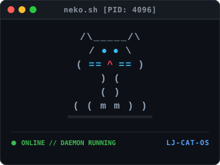
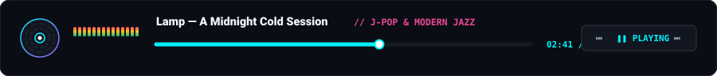

<!-- ============================================================ -->
<!-- TOP GRID: HIGH-RES ANIMATED ASCII CAT + SYNCHRONOUS HEADER  -->
<!-- ============================================================ -->

<table border="0" width="100%" cellspacing="0" cellpadding="0">
  <tr>
    <td width="38%" align="center" valign="middle">
      
    </td>
    <td width="4%"></td>
    <td width="58%" align="center" valign="middle">
      
    </td>
  </tr>
</table>

 

<!-- ============================================================ -->
<!-- SECTION: PHILOSOPHY & INTRO                                  -->
<!-- ============================================================ -->

### `// INTRO & PHILOSOPHY`

> Hi there! I'm **Jerin Rajan**, widely known online as **LJINFINITY**. I am an aspiring software architect, AI developer, and relentless technology enthusiast who truly lives and breathes modern computing.
> 
> My path into software development started with a simple belief: **work should be an engaging, creative journey.** For me, programming isn't just typing lines of code — it's the thrill of starting from a blank editor, enjoying every step of the engineering process, and crafting tools and systems I genuinely desire to see in the world.

 

<!-- ============================================================ -->
<!-- SECTION: THE BIG THREE FLAGSHIP PROJECTS                     -->
<!-- ============================================================ -->

### `// THE BIG THREE FLAGSHIPS`

<table width="100%" cellspacing="0" cellpadding="0">
  <tr>
    <td width="32%" valign="top">
      <h4>🐾 01 // URIEL AI ASSISTANT</h4>
      
Custom autonomous personal AI assistant and multi-agent orchestrator equipped with self-correction loops and tool reasoning.

      

        <code>Python</code> • <code>Multi-Agent</code> • <code>Self-Correction</code>
      

      Status: <b><code>🟢 PRODUCTION</code></b>
    </td>
    <td width="2%"></td>
    <td width="32%" valign="top">
      <h4>🐚 02 // ENOCH SHELL (MYSHELL)</h4>
      
Feature-rich custom desktop environment built completely from scratch with Quickshell to my exact ergonomic liking.

      

        <code>Quickshell</code> • <code>QML</code> • <code>Lua</code> • <code>Hyprland</code>
      

      Status: <b><code>⚡ DAILY RIG</code></b>
    </td>
    <td width="2%"></td>
    <td width="32%" valign="top">
      <h4>🧭 03 // ARC TRACKER</h4>
      
Personal life tracking and reflection engine to monitor life arcs, document milestones, and keep persistent developer journals.

      

        <code>Python</code> • <code>SQLite</code> • <code>Telemetry</code>
      

      Status: <b><code>💎 STABLE</code></b>
    </td>
  </tr>
</table>

 

<!-- ============================================================ -->
<!-- SECTION: KINETIC STACK MARQUEE                               -->
<!-- ============================================================ -->

### `// TECH STACK ENGINE [KINETIC TICKER]`

 

<b><code>[+] Expand Full Categorized Directory</code></b>

 

| Domain | Technologies & Tooling |
| :--- | :--- |
| **Languages & Systems** | `Rust` `C++` `C` `Python` `TypeScript` `JavaScript` `Go` `Bash` `Zsh` `Lua` |
| **AI, Agents & ML** | `PyTorch` `CUDA` `LangChain` `Hugging Face` `OpenCV` `OpenAI API` `Anthropic` `DeepSeek` `Whisper` |
| **Linux & Desktop Rig** | `Fedora` `Arch Linux` `Hyprland (Wayland)` `Quickshell` `QML` `Neovim` `Tmux` `Kitty` `Starship` `RTK` |
| **Web, APIs & Runtimes** | `React` `Next.js` `Tailwind CSS` `Node.js` `FastAPI` `Express` `Django` `GraphQL` `REST` |
| **Data, Cloud & DevOps** | `PostgreSQL` `Redis` `SQLite` `Supabase` `Docker` `Kubernetes` `Git` `GitHub Actions` `AWS` `Vercel` |

 

<!-- ============================================================ -->
<!-- SECTION: NOW PLAYING & ANALYTICS                             -->
<!-- ============================================================ -->

### `// NOW PLAYING [MYSPACE AUDIO TAPE]`

 

### `// TELEMETRY & RUNTIME STATS`

  

 

<!-- ============================================================ -->
<!-- SECTION: CONNECT & DOCK                                      -->
<!-- ============================================================ -->

### `// CONNECT & TRANSMIT`

  

<i>Architected with passion by <b>Jerin Rajan (LJINFINITY)</b> • Purring in flow state 🐾</i>

